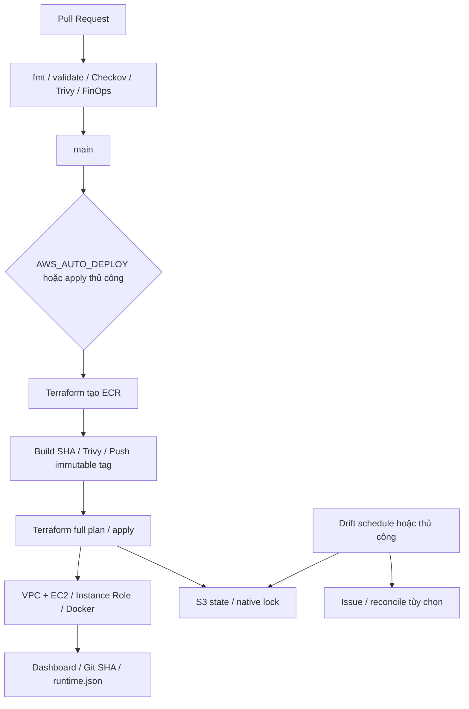

# Terraform · AWS · Registry · GitHub Actions

Đồ án nhóm 3 thành viên. Code tích hợp VPC, ECR, EC2, remote state, OIDC, kiểm tra bảo mật, FinOps và drift.

## Trạng thái và giới hạn

- `AWS_AUTO_DEPLOY=false`: merge không tạo hạ tầng AWS.
- `AWS_DRIFT_ENABLED=false`: lịch drift không gọi AWS trước khi triển khai.
- Thiếu `INFRACOST_API_KEY`: chưa có dự toán giá hoặc comment Infracost. CI chỉ chạy giới hạn tài nguyên tĩnh, không giả nhận đã dự toán.
- Kiểm thử local/CI không chứng minh EC2 User Data, OIDC, S3 lock, Budget email hoặc self-healing chạy thành công trên AWS. Xem [nghiệm thu](ACCEPTANCE.md).
- Không bảo đảm hóa đơn $0: Free Tier/credit, IPv4, EBS, ECR, request S3 phụ thuộc tài khoản và thời điểm. Budget cảnh báo, không chặn chi tiêu.



## Chạy kiểm tra không dùng AWS

```bash
terraform -chdir=environments/prod init -backend=false -input=false
terraform -chdir=environments/prod validate
terraform fmt -check -recursive modules environments/prod
docker build --build-arg GIT_COMMIT_SHA="$(git rev-parse HEAD)" -t thesis-app:test app-demo
bash tests/check.sh
```

CI giữ nguyên sáu required checks cũ, thêm `Validate environments/prod` và `FinOps policy gate`. Trivy không bỏ qua CVE chưa có bản vá. Docker base khóa digest; nâng digest qua PR rồi quét lại. Kích thước image phải đo thực tế, không mặc định 15 MB. Lifecycle giữ ba tag không phải quota cứng theo byte.

## Triển khai demo có kiểm soát

1. Kiểm tra `AWS_ROLE_ARN`, `TF_VAR_ALERT_EMAIL`; thêm `INFRACOST_API_KEY` nếu cần Infracost. Không đưa giá trị vào repository hoặc log.
2. Trong Actions, chọn **02 - CD Terraform Apply**, nhánh `main`, action `plan`. Đọc plan và kiểm tra tài khoản/region trước bước tiếp theo.
3. Chọn action `apply` khi đã chấp nhận chi phí. Workflow tạo riêng ECR, build/scan/push `v-<SHA>`, sau đó full plan/apply. Bước `-target=module.ecr_registry` chỉ giải quyết bootstrap dependency; không dùng thay full apply.
4. Nếu Trivy/push lỗi, EC2 chưa được tạo nhưng ECR/state có thể đã có. Sửa lỗi rồi chạy lại; không xóa state. Tag đã tồn tại không bị ghi đè.
5. Mở output `application_url`; kiểm tra Git SHA và metadata. EC2 chỉ kéo image đúng SHA, không fallback sang Nginx mặc định. User Data đổi sẽ thay EC2; có downtime khi cập nhật demo.
6. Sau khi apply thành công, đặt `AWS_DRIFT_ENABLED=true` để bật kiểm tra drift. Workflow dùng image tag trong state, không tự đổi phiên bản app. `auto_reconcile=true` chỉ áp dụng khi chạy thủ công trên `main`.
7. Chụp minh chứng rồi đặt `AWS_DRIFT_ENABLED=false`. Chọn action `destroy`, nhập `DESTROY`. Thao tác xóa vĩnh viễn tài nguyên prod và image ECR; không chạy destroy bootstrap. Kiểm tra EC2/EBS/IPv4 sau đó.

`AWS_AUTO_DEPLOY=true` bật tự động triển khai sau thay đổi hạ tầng/app trên `main`. Chỉ bật sau nghiệm thu AWS. CD và drift cùng concurrency `terraform-prod`; native S3 lock vẫn bảo vệ khi chạy Terraform ngoài Actions.

FinOps tĩnh chặn instance khác `t3.micro`, root disk khác 8 GiB, replica và các resource trả phí ngoài phạm vi. Khi có API key, thêm ngưỡng **$20/tháng giá niêm yết**, không trừ credit/Free Tier. Đây là ngưỡng lab đã ghi trong `tests/finops.py`, không phải ước tính hóa đơn thực. Fork PR không nhận secret nên không có Infracost comment.

## Module và phiên bản

| Module | Input chính | Output |
|---|---|---|
| `modules/vpc` | environment, region, VPC/subnet CIDR | vpc_id, public_subnet_id, web_sg_id |
| `modules/ecr-registry` | environment, repository_name | repository_url, repository_arn, repository_name |
| `modules/compute-ec2` | subnet, SG, ECR URL, image_tag, region | instance_id, public_ip |

Module trong monorepo dùng relative source để review/validate cùng phiên bản. Đây là cấu trúc module tái sử dụng, **chưa phải private Terraform Registry được xuất bản**. Git tag Semantic Versioning (`vMAJOR.MINOR.PATCH`) là phiên bản mã nguồn: breaking input/output tăng MAJOR, tính năng tương thích tăng MINOR, sửa lỗi tăng PATCH. Consumer ngoài repo có thể khóa Git source `git::https://github.com/Hulk1809/aws-terraform-gitops-thesis.git//modules/vpc?ref=<reviewed-tag-or-commit>`; chỉ dùng tag/commit tồn tại. Không nhầm Git source với Registry `version` constraint.

## Phân công và tài liệu

- TV1: bootstrap/OIDC/state, prod, Budget, CI/CD, quản trị repository.
- TV2: VPC, EC2/User Data, interface module và versioning.
- TV3: ECR, app, Trivy, Infracost, drift/reconcile.
- [Quy trình demo](DEMO_GUIDE.md), [nghiệm thu](ACCEPTANCE.md), [báo cáo kỹ thuật](REPORT.md).

Ngoại lệ Checkov nằm đúng resource, có lý do: AES256 thay KMS, không tạo flow logs/detailed monitoring trả phí, HTTP public demo, SG nối qua module, public IPv4 thay NAT. Không tắt toàn bộ scanner. IAM triển khai bootstrap hiện còn quyền rộng `PowerUserAccess` + `IAMFullAccess`; chỉ dùng tài khoản lab, cần thu hẹp trước production. EC2 dùng read-only ECR, không lưu Access Key. IMDSv2 chỉ gọi từ host; container không nhận token hoặc IAM credentials.
